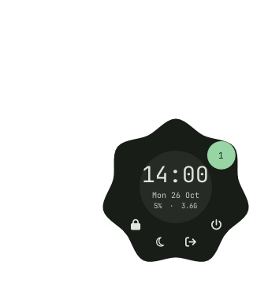

# LNF — Love Nature Frames

[](https://github.com/baduga2007-netizen/Love-Nature-Frames/actions/workflows/build.yml)

LNF is a Wayland layer-shell panel written in pure Go. It doesn't replace your
window manager — it draws the bar and the widgets on top of one (sway/swayfx,
niri, Hyprland).



What about resource usage? I tested it on my own hardware:

- ~23 MB PSS (26.5 MB RSS)
- 0.3% of one core, averaged over two hours
- 19 threads, 25 seconds of CPU time in that time

Under the hood: no cgo, no GL, no JS runtime.

Don't expect pure bliss: the config is Go too, so every change means a
recompile. That's the trade-off for the low footprint.

## Requirements

- **Go 1.21+** — that's the real minimum, verified against the language features
  and dependencies actually used.
- A compositor with `wlr-layer-shell`: sway/swayfx, niri or Hyprland.
- A Nerd Font for the default panels — JetBrainsMono NF is tried first, the icons
  are Font Awesome glyphs. Pick any sans font and swap the glyphs if you don't
  want one.

Only the widgets you actually use need their tools:

| Tool | Used for |
| --- | --- |
| `grim`, `slurp` | screenshot widget |
| `wl-clipboard` (`wl-copy`, `wl-paste`) | clipboard widget |
| `wpctl` (PipeWire) | volume OSD |
| `swaybg` / `swww` / `awww` | wallpaper switcher |
| `swaylock` | lock action |
| `jq` | exact window geometry for screenshots (optional) |

Everything is plain `sh`, no bashisms.

## Build & run

Clone into `~/LNF` — the scripts call each other by that path:

```sh
git clone https://github.com/baduga2007-netizen/Love-Nature-Frames.git ~/LNF
cd ~/LNF
go build -o lnf .
./lnf
```

The panel is defined in `panel.go` (`panelConfig`) — edit it and rebuild. Full
reference: [CONFIG.md](CONFIG.md).

Start it with the compositor:

```sh
# sway: config
exec ~/LNF/lnf
```

```kdl
# niri: config.kdl
spawn-sh-at-startup "~/LNF/lnf"
```

```ini
# Hyprland: hyprland.conf
exec-once = ~/LNF/lnf
```

The shell scripts talk to the running panel through a FIFO, so you can poke it
by hand:

```sh
~/LNF/lnf.sh apps      # open the app launcher
~/LNF/lnf.sh notify hi # show a message in the OSD
~/LNF/lnf.sh set vol "██░ 45%"
```

Render the scenes to PNG without a compositor:

```sh
LNF_DUMP=out.png ./lnf
```

## License

CC BY-NC-SA 4.0. Fork it, credit the author, keep the same license, don't
sell it. Full terms in [LICENSE](LICENSE).

Copyright (c) 2026 baduga2007-netizen

---

Be good to each other, enjoy it, and please respect the license.

And of course: make friends with every distro, respect systemd, hate Ubuntu.
